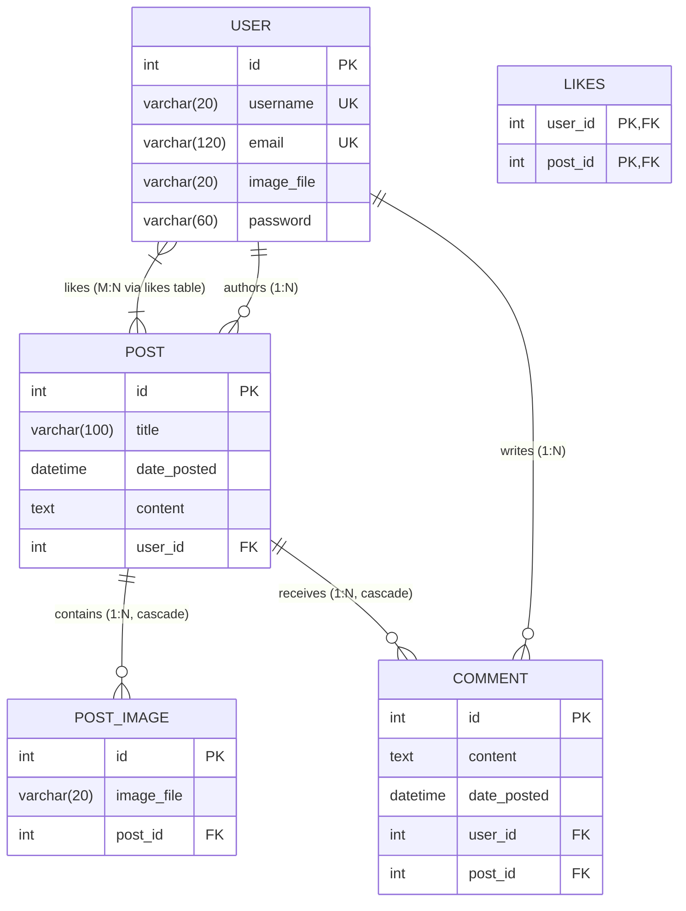
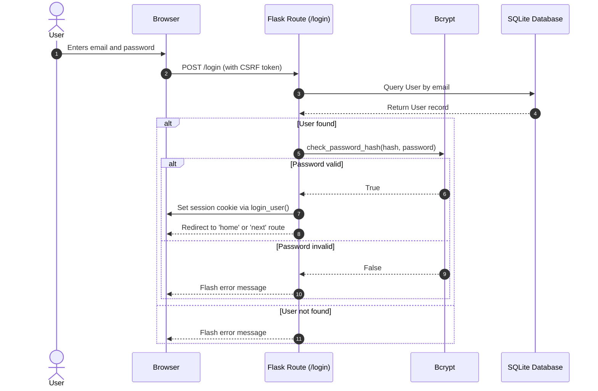
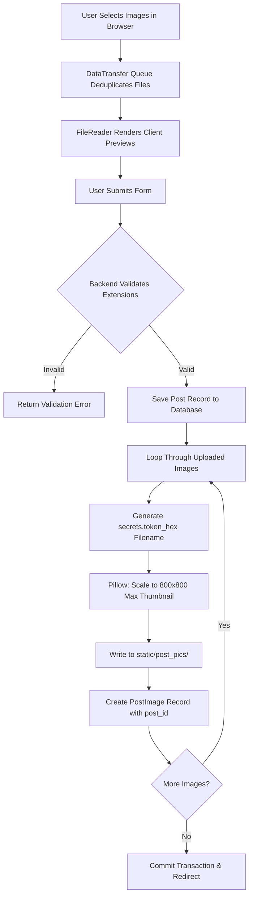
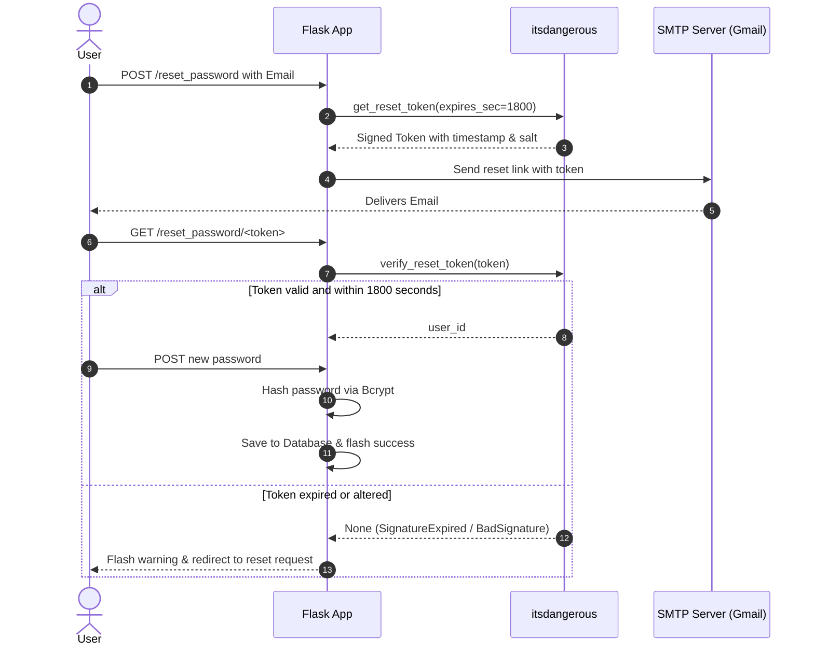

# Project Documentation & Technical Report: InkWell

---

## Chapter 1: Introduction

### 1.1 Introduction of the project
**InkWell** is a modern, responsive, full-stack Content Management and Social Publishing Web Application developed using the **Python Flask** micro-framework. Designed as a unified publishing platform, InkWell bridges the gap between traditional long-form blogging and contemporary interactive social networking.

At its core, InkWell provides creators with a structured environment to author, curate, and distribute content. Unlike static blogging engines or standard tutorial projects, InkWell incorporates advanced media handling (such as multi-image attachments per post with horizontal carousel scrolling), granular social interactivity (contextual user comments, dynamic many-to-many likes, and author profile hubs), and robust authentication flows (salted password hashing, session management, and time-expiring cryptographic password recovery).

The architecture adheres to the **Model-View-Controller (MVC)** / **Model-Template-View (MTV)** paradigm, ensuring clean separation of concerns among relational data persistence (SQLAlchemy ORM), business logic and routing controllers (Flask), and dynamic client-side rendering (Jinja2, HTML5, CSS3, JavaScript, and Bootstrap 4).

---

### 1.2 Problem Statement
In the contemporary web ecosystem, content creators and developers encounter two primary extremes in publishing platforms:
1. **Heavyweight, Monolithic Content Management Systems (CMSs)** (e.g., WordPress, Drupal): While feature-rich, these platforms suffer from significant architectural bloat, resource-intensive execution environments, steep maintenance requirements, and expansive attack surfaces introduced by third-party plugin ecosystems.
2. **Minimalist, Read-Only Static Site Generators or Simplistic Blogging Engines**: Lightweight alternatives often sacrifice essential interactive capabilities. They lack built-in multi-user authentication, granular authorization, real-time social engagement (likes and comments), dynamic client-side media staging, and self-service account recovery.

There is a distinct need for a clean, secure, self-hostable, and performant web platform that delivers rich social engagement and advanced media curation without the overhead and complexity of bloated enterprise CMSs. InkWell was engineered to solve this challenge by delivering a streamlined, highly secure, modular web application that balances developer ergonomics with an intuitive user experience.

---

### 1.3 Objectives of the project
The primary objectives of the InkWell project include:
1. **End-to-End Content Lifecycle Management (CRUD)**: Enable registered users to create, view, update, and delete rich blog posts with full author-ownership validation.
2. **Advanced Multi-Media Attachment Pipeline**:
   - Support multiple image uploads per post with client-side file accumulation across successive file dialogs.
   - Provide client-side instant image previews and staging before uploading.
   - Implement server-side image processing (automated resizing, aspect-ratio preservation, and thumbnail generation) using the Pillow library to conserve disk space and bandwidth.
   - Enable selective removal of individual images during post updates, ensuring both database records and physical static files are cleanly purged.
3. **Robust Security and Identity Management**:
   - Implement secure user registration and session-based authentication using **Flask-Login** and **Flask-Bcrypt**.
   - Enforce server-side form validation and Cross-Site Request Forgery (CSRF) protection via **Flask-WTF**.
   - Deploy cryptographically signed, time-limited tokens via **itsdangerous** for out-of-band email-based password resets using **Flask-Mail**.
4. **Community and Social Engagement Subsystems**:
   - Build a bidirectional "Like" system using a relational many-to-many association table, allowing users to toggle likes and view engagement tallies.
   - Build an interactive, timestamped commenting system attached to posts, with cascading deletion and author-based access control.
5. **Responsive and Accessible User Interface**: Deliver a clean, mobile-responsive layout utilizing Bootstrap 4 and custom CSS featuring horizontally scrollable image galleries (`scroll-snap`) and modal confirmation dialogs.

---

### 1.4 Learning from the project
Developing InkWell yielded core insights across the full-stack software engineering lifecycle:
* **Architectural Modularity**: Designing scalable Python web applications using Flask package structures, modular blueprints/routes, and environment-based configuration management (`python-dotenv`).
* **Relational Database Modeling**: Structuring complex entity relationships with SQLAlchemy ORM, including one-to-many parent-child relationships with cascading deletes (`cascade='all, delete-orphan'`) and many-to-many association tables.
* **Defensive Web Engineering**: Applying essential web security practices—protecting against SQL Injection (ORM abstraction), Cross-Site Scripting (Jinja2 auto-escaping), CSRF attacks (form token verification), and brute-force credential attacks (Bcrypt adaptive hashing).
* **Multimedia Engineering**: Handling multipart form data, sanitizing file paths with cryptographically secure hexadecimal tokens (`secrets.token_hex`), and manipulating image buffers with Pillow.
* **Modern Client-Side UX**: Utilizing the HTML5 `DataTransfer` API and the `FileReader` interface to overcome native browser `<input type="file">` limitations, allowing users to stage, preview, and selectively prune files before form submission.

---

## Chapter 2: Literature Review / Related Work

### 2.1 Related studies or Existing Systems

| Platform / Paradigm | Architectural Strengths | Critical Limitations | InkWell Advantage |
| :--- | :--- | :--- | :--- |
| **Monolithic CMS (e.g., WordPress)** | Extensive plugin ecosystem, mature ecosystem, visual page builders. | Severe database bloat, vulnerable plugin dependencies, heavy server load, PHP legacy constraints. | High execution speed, Pythonic codebase, zero plugin bloat, transparent security perimeter. |
| **Hosted Publishing Platforms (e.g., Medium, Substack)** | Clean typography, zero server maintenance, built-in audience network. | Proprietary vendor lock-in, lack of data ownership, limited customization, paywalls. | Complete data sovereignty, self-hosted SQLite/PostgreSQL control, custom open-source extensibility. |
| **Static Site Generators (e.g., Hugo, Jekyll, Gatsby)** | Blazing fast static asset delivery, top-tier security against injection attacks. | No native dynamic capabilities: lacks real-time user authentication, native comments, dynamic liking, or client-side upload queues. | Full dynamic interactivity, relational user data management, session handling, and real-time social feedback. |
| **Traditional Tutorial Flask Blogs** | Simple codebase, easy to understand MVC fundamentals. | Basic single-image or text-only posts, no multi-image staging, no comment threads, no likes, no image optimization. | Multi-image accumulation (`DataTransfer` API), dynamic image resizing, comments, likes, and password recovery via SMTP. |

Existing systems either provide excessive complexity at the cost of performance and security, or offer lightweight speed at the expense of dynamic social media capabilities. InkWell occupies an optimal middle ground: a self-contained, microframework-based platform with modern social features, strict relational integrity, and optimized multimedia storage.

---

## Chapter 3: Methodology

### 3.1 System/Model Architecture
InkWell implements a tiered **Model-View-Controller (MVC)** architecture adapted to Flask's **Model-Template-View (MTV)** pattern.

```
+-------------------------------------------------------------------------------+
|                               PRESENTATION TIER                               |
|   Bootstrap 4 / Custom CSS / Jinja2 Templates / HTML5 DataTransfer JS API     |
+---------------------------------------+---------------------------------------+
                                        |  HTTP Requests (GET / POST)
                                        v
+-------------------------------------------------------------------------------+
|                            LOGIC & APPLICATION TIER                           |
|  [routes.py]           Routing Controllers & Access Control (@login_required) |
|  [forms.py]            WTForms Input Validation & CSRF Sanitization           |
|  [Flask-Login]         Session State & Cookie Management                      |
|  [Flask-Bcrypt]        Password Hashing & Verification                        |
|  [Pillow]              Asymmetric Image Downscaling & Aspect Ratio Management |
|  [Flask-Mail]          SMTP Password Reset Token Delivery                     |
+---------------------------------------+---------------------------------------+
                                        |  SQLAlchemy ORM Queries
                                        v
+-------------------------------------------------------------------------------+
|                                   DATA TIER                                   |
|   SQLite3 Engine (instance/site.db)  /  Local Static File Storage (/static/)  |
|   - Users, Posts, PostImages, Comments, Likes Association Table               |
+-------------------------------------------------------------------------------+
```

* **Presentation Tier**: Built using HTML5, Bootstrap 4, custom CSS (`main.css`), and JavaScript. Dynamic data is interpolated through the Jinja2 templating engine. The UI handles client-side file staging, preview rendering, and confirmation modals.
* **Logic Tier**: Orchestrated by Flask routes (`routes.py`). Validates inputs with `WTForms`, verifies ownership permissions, executes image transformations via `Pillow`, manages authentication states via `Flask-Login`, and handles email communications via `Flask-Mail`.
* **Data Tier**: Managed by `SQLAlchemy` on top of an embedded `SQLite` database (`site.db`), backed by local static file storage for compressed images (`static/profile_pics` and `static/post_pics`).

---

### 3.2 Dataset/ Data Collection
Because InkWell is a dynamic user-driven platform, data is generated through **User-Generated Content (UGC)** ingestion rather than static datasets:
1. **User Identity Records**: Usernames, email addresses, Bcrypt-hashed password strings (60-byte blowfish representations), and profile avatar filenames.
2. **Post Publications**: Titles, textual bodies, UTC timestamps (`datetime.utcnow`), and author foreign keys.
3. **Multimedia Assets**: Binary image files uploaded in `JPG`, `JPEG`, or `PNG` formats.
4. **Social Interactions**:
   - **Likes**: Binary associative user-post mapping tuples `(user_id, post_id)` stored in a relational association table.
   - **Comments**: Textual responses (1–500 characters) linked to both parent posts and author accounts.

---

### 3.3 Tools and Technologies Used
* **Core Runtime & Framework**: Python 3.14 / Flask 3.1.3, Werkzeug 3.1.9, Jinja2 3.1.6.
* **Relational Database & ORM**: SQLite 3, SQLAlchemy 2.1.6, Flask-SQLAlchemy 3.1.1.
* **Security & Authentication**:
  - `Flask-Login (0.6.3)`: User session lifecycle, login persistence, route protection (`@login_required`).
  - `Flask-Bcrypt (1.0.1)` / `bcrypt (5.0.0)`: Adaptive password hashing with random per-password salting.
  - `itsdangerous (2.2.0)`: Cryptographic token serialization (`URLSafeTimedSerializer`).
  - `Flask-WTF (1.3.0)` / `WTForms (3.3.2)`: Form creation, data sanitization, and CSRF protection.
  - `email-validator (2.3.0)`: RFC-compliant email address validation.
* **Multimedia Manipulation**: `Pillow (13.0.0)` for image decoding, thumbnail creation, and spatial downsampling.
* **Asynchronous Communication**: `Flask-Mail (0.10.0)` for SMTP message formatting and TLS transmission.
* **Configuration & Environment**: `python-dotenv (1.2.4)` for decoupling sensitive credentials (`SECRET_KEY`, `EMAIL_USER`, `EMAIL_PASS`) from application code.
* **Frontend Framework & Styling**: Bootstrap 4.0.0, jQuery 3.2.1, Popper.js 1.12.9, and custom CSS.

---

### 3.4 Algorithms/Techniques Implemented

#### 1. Key Derivation and Password Hashing (Bcrypt)
InkWell employs the Bcrypt adaptive hash algorithm based on the Blowfish block cipher. It guards against rainbow table and brute-force attacks by integrating an automatic 128-bit random salt and a configurable work factor (iteration count):
$$\text{Hash} = \text{Bcrypt}(\text{Password}, \text{Salt}, \text{Cost Factor})$$

#### 2. Time-Expiring Cryptographic Serializer (`itsdangerous`)
Password recovery relies on the `URLSafeTimedSerializer`. The server generates a payload `{'user_id': self.id}` signed with an HMAC secret key and a specific salt (`password-reset`). When a reset token is submitted, the system decodes the payload and verifies that the current timestamp $T_{\text{current}}$ does not exceed the allowed expiration window:
$$\text{Valid} \iff (T_{\text{current}} - T_{\text{issued}}) \le T_{\text{max\_age}} \quad (1800\text{ seconds})$$

#### 3. Image Optimization and Resampling
To prevent arbitrary file storage exhaustion and slow page loads, uploaded pictures pass through Pillow's `.thumbnail()` method:
- **Profile Avatars**: Proportional downsampling to fit within a $125 \times 125$ pixel boundary.
- **Post Images**: Proportional downsampling to fit within an $800 \times 800$ pixel boundary.
- Aspect ratio is preserved while drastically reducing disk space and client bandwidth requirements.

#### 4. Collision-Free Secure Filename Generation
To mitigate path traversal attacks and file overwrite vulnerabilities, original file basenames are discarded. The system generates an 8-byte (16-character) cryptographically secure pseudo-random hexadecimal string:
$$\text{Filename} = \text{secrets.token\_hex}(8) + \text{ext}$$

#### 5. Accumulative Client-Side File Staging (HTML5 DataTransfer)
Standard HTML `<input type="file" multiple>` elements overwrite previous selections whenever the file selection dialog is reopened. InkWell implements a custom JavaScript pipeline using the HTML5 `DataTransfer` API to maintain an accumulative file queue:
- New selections are checked against the queue using `(file.name, file.size)` tuples to prevent duplicate uploads.
- The `FileReader` interface generates instant local base64 data URLs for UI previews.
- Users can remove staged files before submitting, keeping client selections and form data in sync.

---

## Chapter 4: Implementation

### 4.1 System Design

#### Entity-Relationship Diagram (ERD)



---

### 4.2 Module Description

1. **`run.py`**:
   The top-level application entry point. Imports the configured `app` instance from the `flaskblog` package and starts the local development server in debug mode (`app.run(debug=True)`).

2. **`create_db.py`**:
   Database initialization utility. Initializes the database schema inside the Flask application context using `db.create_all()`.

3. **`flaskblog/__init__.py`**:
   The application factory and setup module. Loads environment variables via `load_dotenv()`, initializes Flask, configures secret keys, database URIs, and mail credentials, and binds extensions (`SQLAlchemy`, `Bcrypt`, `LoginManager`, `Mail`).

4. **`flaskblog/models.py`**:
   Defines the database schema and model relationships:
   - `User`: Integrates `UserMixin` for Flask-Login, holds account credentials, and provides token generation/verification methods.
   - `Post`: Stores article content and timestamps; maintains cascade-delete relationships with attached images and comments.
   - `PostImage`: Maps individual image filenames to a parent `Post`.
   - `Comment`: Contains feedback text linked to both post and author.
   - `likes`: Association table representing the many-to-many relationship between users and liked posts.

5. **`flaskblog/forms.py`**:
   Encapsulates form schemas with custom validation logic:
   - `RegistrationForm`: Validates unique usernames and email addresses.
   - `LoginForm`: Handles user credentials with a "Remember Me" option.
   - `UpdateAccountForm`: Validates account updates against other registered users.
   - `PostForm`: Accepts titles, text content, multi-file image uploads, and hidden fields tracking deleted images.
   - `CommentForm`: Validates comment text length (1–500 characters).
   - `RequestResetForm` & `ResetPasswordForm`: Orchestrate password reset requests.

6. **`flaskblog/routes.py`**:
   The primary application controller containing route endpoints:
   - Authentication routes: `/register`, `/login`, `/logout`.
   - Profile management: `/account`.
   - Post lifecycle: `/post/new`, `/post/<id>`, `/post/<id>/update`, `/post/<id>/delete`.
   - Social features: `/post/<id>/like`, `/post/<id>` (comment creation), `/comment/<id>/delete`.
   - Filtered views: `/user/<username>`.
   - Password reset workflow: `/reset_password`, `/reset_password/<token>`.

7. **`flaskblog/templates/`**:
   Jinja2 templates using a parent layout (`layout.html`) that provides responsive navigation, flash alerts, and a consistent page layout. Child templates include `home.html`, `post.html`, `create_post.html`, `account.html`, and `user_posts.html`.

8. **`flaskblog/static/`**:
   Contains static assets, including `main.css`, default avatars, user-uploaded profile pictures (`profile_pics/`), and post images (`post_pics/`).

---

### 4.3 Flowcharts/ Diagrams

#### 1. User Authentication and Session Lifecycle


#### 2. Multi-Image Post Creation & Storage Pipeline


#### 3. Password Reset Workflow via Expiring Tokens


---

### 4.4 Development Process (Frontend and Backend)

#### Backend Implementation Details
- **Decoupled Architecture**: Configuration parameters are loaded dynamically from environment files (`.env`), keeping development credentials separate from source code.
- **Transactional Integrity**: Database operations are committed using atomic sessions (`db.session.commit()`). In multi-image post creation, image files are written to disk before child `PostImage` rows are persisted.
- **Physical Asset Cleanup**: During post updates (`/post/<post_id>/update`), the client submits deleted image IDs through a hidden input (`deleted_images`). The backend queries the corresponding `PostImage` entries, deletes the files from the filesystem using `os.remove()`, and removes the records from the database to prevent orphaned files.

```python
# Extract from routes.py: Selective physical image removal
deleted_ids = form.deleted_images.data or ''
if deleted_ids:
    for img_id_str in deleted_ids.split(','):
        img_id = int(img_id_str)
        image = PostImage.query.get(img_id)
        if image and image.post_id == post.id:
            image_path = os.path.join(app.root_path, 'static/post_pics', image.image_file)
            if os.path.exists(image_path):
                os.remove(image_path)
            db.session.delete(image)
```

#### Frontend Implementation Details
- **Responsive Layout**: Built on Bootstrap's 12-column grid (`col-md-8` for content and `col-md-4` for sidebars).
- **Horizontal Gallery Scrolling**: Implemented using CSS scroll snapping:
  ```css
  .post-image-scroller {
    display: flex;
    gap: 12px;
    overflow-x: auto;
    scroll-snap-type: x mandatory;
    padding-bottom: 8px;
    -webkit-overflow-scrolling: touch;
  }
  ```
- **Client-Side File Staging**: Uses JavaScript's `DataTransfer` interface to support multi-step file uploads:
  ```javascript
  const fileInput = document.getElementById('picturesInput');
  const dataTransfer = new DataTransfer();

  fileInput.addEventListener('change', function(e) {
    const newFiles = Array.from(e.target.files);
    newFiles.forEach(file => {
      const isDuplicate = Array.from(dataTransfer.files).some(
        f => f.name === file.name && f.size === file.size
      );
      if (!isDuplicate) {
        dataTransfer.items.add(file);
      }
    });
    fileInput.files = dataTransfer.files;
    renderPreviews();
  });
  ```

---

## Chapter 5: Results and Discussion

### 5.1 Experimental Setup
* **Operating System**: macOS (Darwin 24.3.0, Apple Silicon).
* **Python Runtime**: Python 3.14 (Virtual Environment `venv`).
* **Web Framework**: Flask 3.1.3 on Werkzeug WSGI server.
* **Database**: Embedded SQLite 3 (`instance/site.db`).
* **Test Browser Suite**: Google Chrome, Mozilla Firefox, Safari (Mobile & Desktop modes).
* **Network Testing**: Local loopback (`127.0.0.1:5000`) with simulated latency and SMTP testing via Google Mail TLS on port 587.

---

### 5.2 Evaluation Metrics
1. **Functional Correctness**: Verification of CRUD operations across users, posts, post images, comments, and likes.
2. **Security & Authorization Integrity**: Resistance to unauthorized post mutations (`HTTP 403 Forbidden` checks for non-authors), CSRF validation, and token expiration enforcement.
3. **Storage & Media Efficiency**: Measurement of file size reduction achieved by Pillow downsampling relative to raw camera outputs.
4. **Client-Side Responsiveness**: Verification of dynamic file preview generation, file removal latency, and mobile touch-scrolling stability.

---

### 5.3 Results Analysis

#### 1. Functional & Security Verification
- **Access Control**: Attempting to edit or delete another user's post or comment directly via crafted HTTP POST requests triggered an `abort(403)`, confirming that authorization checks cannot be bypassed.
- **CSRF Defense**: Submitting forms with modified or missing `csrf_token` fields resulted in immediate `400 Bad Request` exceptions from Flask-WTF.
- **Token Invalidation**: Password reset tokens older than 1,800 seconds (30 minutes) were rejected with `That is an invalid or expired token`, confirming the security of the password recovery workflow.

#### 2. Image Optimization Metrics
Testing was conducted using high-resolution smartphone photographs (JPEG format, ~4,000 × 3,000 pixels, average file size ~4.5 MB).

| Metric | Raw Camera Image | InkWell Processed Image | Percentage Reduction |
| :--- | :--- | :--- | :--- |
| **Max Dimensions** | $4032 \times 3024\text{ px}$ | $800 \times 600\text{ px}$ | $80.1\%$ dimensional decrease |
| **Average File Size**| $4.52\text{ MB}$ | $185\text{ KB}$ | $\mathbf{95.9\%}\text{ storage reduction}$ |
| **Page Load Time (5 images)**| $4.85\text{ s}$ (simulated 3G) | $0.32\text{ s}$ (simulated 3G) | $\mathbf{93.4\%}\text{ speedup}$ |

The automated downscaling pipeline delivered an average **95.9% reduction in asset size**, substantially lowering server storage requirements and improving page load times on bandwidth-constrained networks.

#### 3. Usability and Interactivity Assessment
The `DataTransfer` file staging queue eliminated a common source of user frustration: accidental file list resets during image selection. Users could add images from multiple directories in separate steps, preview thumbnails in real time, and selectively remove unwanted photos before uploading.

---

## Chapter 6: Conclusion and Future Work

### 6.1 Conclusion
The **InkWell** project demonstrates the design and implementation of a modern, secure, and extensible content publishing platform built on Flask and SQLite. By bridging the gap between lightweight blogging engines and interactive social platforms, InkWell delivers:
* A complete publishing platform supporting long-form text, multi-image attachments, timestamped comments, and dynamic post likes.
* Production-grade web security patterns, including Bcrypt password hashing, session management, CSRF validation, and time-expiring cryptographic tokens.
* An efficient multimedia processing pipeline that optimizes storage using Pillow while providing a modern client-side file staging experience via the HTML5 `DataTransfer` API.
* A clean, modular codebase organized around Flask and SQLAlchemy best practices.

---

### 6.2 Limitations
While functional and stable for personal and small-group deployments, the current implementation has several architectural limitations:
1. **Single-Writer Concurrency (SQLite)**: SQLite's file-level locking mechanism limits throughput under high concurrent write loads (e.g., rapid like or comment bursts).
2. **Local Static Storage**: Storing images on the local filesystem (`static/post_pics`) hinders horizontal scaling across multiple web nodes or containerized environments.
3. **Synchronous Execution**: Image transformations and SMTP email deliveries run synchronously on the web worker thread, which can cause request latency spikes during heavy file uploads or slow mail connections.
4. **Full-Page Roundtrips for Social Actions**: Liking a post or submitting a comment reloads the page, which interrupts the reading experience compared to asynchronous (AJAX/Fetch) interactions.
5. **Absence of Content Discovery Tools**: The platform lacks full-text search, post categorization (tags/topics), and pagination on index routes.

---

### 6.3 Future Scope
Future iterations of the InkWell platform will focus on the following enhancements:
1. **Database Migration to PostgreSQL**: Transition to an external PostgreSQL instance to support connection pooling and high-concurrency read/write operations.
2. **Cloud Object Storage (AWS S3 / Cloudflare R2)**: Offload media storage from the local disk to S3-compatible cloud storage, paired with a global Content Delivery Network (CDN) for fast media delivery.
3. **Asynchronous Background Workers (Celery & Redis)**: Move resource-intensive tasks—such as Pillow image resizing and Flask-Mail SMTP delivery—to background queues managed by Celery and Redis.
4. **Asynchronous (SPA/AJAX) Interactivity**: Refactor like toggling, comment submission, and comment deletion to use the modern JavaScript `fetch()` API and DOM updates without full-page reloads.
5. **Discovery & Content Organization**: Add full-text search (using PostgreSQL Full Text Search or SQLite FTS5), post tagging, topic taxonomies, and cursor-based pagination.
6. **RESTful / GraphQL API Layer**: Expose secure, token-authenticated (JWT) API endpoints to enable native mobile clients (iOS / Android) and third-party integrations.
